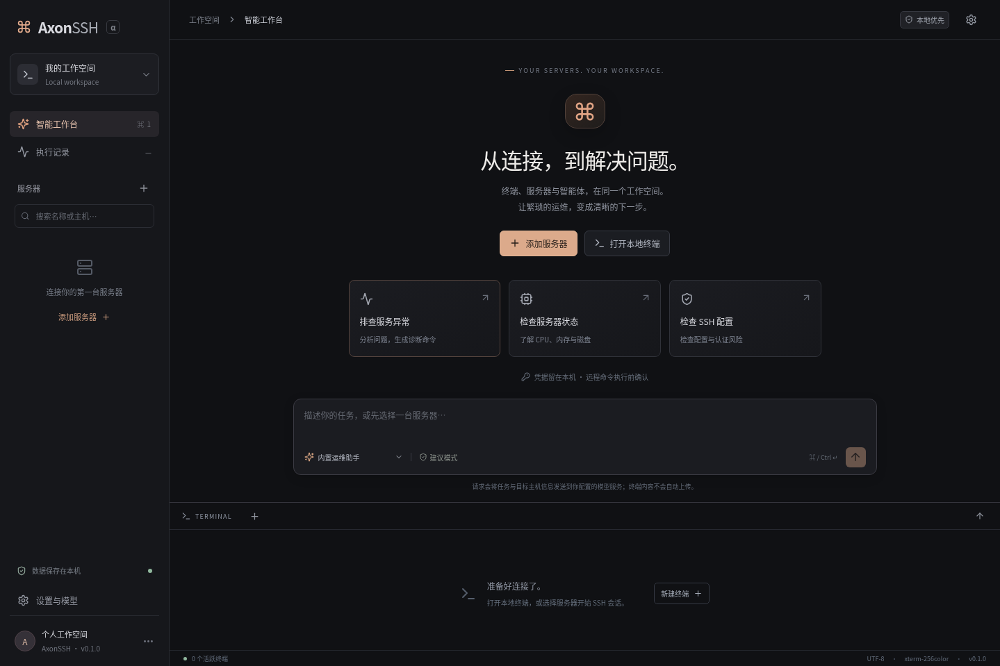

# AxonSSH

A local-first desktop workspace for SSH servers, terminals, and AI-assisted operations. Built with Electron, React, and TypeScript; inspired by the task-oriented layouts of Codex Desktop and Claude Desktop.

> **v0.1.1 alpha:** configurable workspaces and collapsible terminal/agent panels, real SSH and local terminals, encrypted credential storage, model-assisted command proposals, jump-host chaining with OpenSSH config import, and optional local CLI adapters. Remote commands require native confirmation by default; an explicit per-Session Bypass permissions policy can skip it.



中文：AxonSSH 是一款本地优先的 SSH 桌面工作台，包含真实终端、服务器管理、SFTP 目录浏览、内置运维建议助手和可选 Codex / Claude Code 接入。初版支持逐条审批执行远程命令；尚未实现自主多步运维、文件编辑与断线恢复。

## Quick start

Requires Node.js **22.12 or newer**, npm, and native build tools for `node-pty`.

```bash
git clone https://github.com/Yuna-Celisse/AxonSSH.git
cd AxonSSH
npm ci
npm run dev
```

Native prerequisites: macOS Xcode Command Line Tools; Windows Python and Visual Studio C++ Build Tools; Linux Python, make, GCC/G++, and Electron's GTK/NSS runtime libraries. The install hook rebuilds native modules for Electron.

```bash
npm run typecheck
npm test
npm run test:desktop
npm run build
npm run dist
```

`npm run dist` packages for the current operating system. Output goes to `release/`. Local development builds are unsigned; OS signing and notarization are not configured yet.

On Windows, `npm run dist:win` packages with the Windows native binaries included in `node-pty` instead of rebuilding them. Run `npm run test:desktop` first to validate the terminal on the target machine. Source rebuilds additionally require the matching Visual Studio C++ Spectre-mitigated libraries.

Desktop integration tests require a display; on Linux CI, run `xvfb-run -a npm run test:desktop`. They launch the real Electron application with a temporary profile and local SSH/model fixtures, and intercept native dialogs only inside the test process.

## Implemented

- Server profiles with groups, search, password/private-key/SSH-agent authentication, edit and delete.
- Native host-key confirmation on first connection and pinned SHA-256 host keys; changed keys are rejected.
- Real SSH PTY and local terminal tabs, xterm rendering, resize, terminal search, and maximize.
- Independent SSH `exec` channels for approved commands, separate stdout/stderr, exit status, bounded output, and a 60-second timeout.
- SFTP directory browsing, including parent navigation and explicit path input.
- Jump hosts: a profile can connect through another profile over SSH direct-tcpip forwarding, with cycle detection when saving and delete protection while it is still referenced.
- OpenSSH config import from `~/.ssh/config`, following `Include` files. Entries that cannot be represented are reported instead of being silently imported as direct connections.
- Built-in advisory assistant using an OpenAI-compatible Chat Completions endpoint. Supports local HTTP endpoints and remote HTTPS endpoints.
- Structured command proposals, exact target/command binding, single-use approval tokens, and a native confirmation dialog before execution.
- Optional Codex CLI and Claude Code detection, advisory chat adapters, cancellation, and native interactive CLI terminal launch.
- SQLite persistence (SQL.js) and OS-backed Electron `safeStorage` encryption; secrets are never returned through the renderer API.
- Local operation history, including unknown status after transport errors or timeout.
- A browser-only UI preview that explicitly disables SSH, terminal, model, and credential operations.

## First session

The composer exposes only a per-Session permission policy. New Sessions default to Local, including in projects associated with servers. Choose Local or an associated server in the persistent target selector. Adding a server does not change the target. Selecting a server reveals a Connect button; connecting establishes SSH without opening a terminal. Remote tasks require that connection. Each task collects bounded read-only status from the selected location and displays the snapshot; arbitrary commands are never run by this status collector.

Use **Projects & Sessions → +** to create a project and select its associated locations. **Local** and multiple server profiles can be selected together. The project can keep both an existing local directory for CLI/terminal work and an optional Linux remote directory for file browsing. The Session header selects one target—Local or an associated host. New Sessions default to Local; associating multiple locations does not batch execution. Projects group Sessions within a workspace. New Sessions inherit the current project; use the Session header's project selector to move a conversation or return it to **Unassigned**. Existing conversations remain unassigned on upgrade, and existing location/server associations are preserved. Project management supports renaming, changing associations/directories, archiving, and unarchiving; archiving retains Sessions and never deletes files.

Local project directories are used as working directories for advisory CLI calls, native CLI launches, and local terminals. Remote paths are not resolved as local folders; saving them does not create remote directories. The local directory remains usable while a server is selected as the Session target. SSH terminal directories are unchanged, and CLI agents still run locally. The built-in assistant receives project metadata but does not automatically read files. Project assignment/directory changes isolate subsequent engine contexts while preserving previous messages, native IDs, handoffs, and execution records. Running tasks must finish or stop before changing their project location or associated targets.

In **Settings & models → Appearance**, choose **System**, **Light**, or **Dark**. The choice applies immediately to the workspace, menus, forms, and terminal, and persists locally. System mode follows OS theme changes while the application is running.

Use the workspace selector's **+** button to create a workspace and optionally associate existing server profiles. New profiles are added to the current workspace. Workspaces can share a server profile; editing its connection settings updates that shared profile.

The sidebar organizes **workspaces, Sessions, and servers**. Create Sessions with the **+** button and rename the current Session in its header. Each Session contains its own conversation and **Execution records** tab. The top toolbar provides peer **Intelligent workspace** and **Terminal** views. In the workspace view, open or collapse the terminal on the right. In the terminal view, open or collapse the assistant on the right. The secondary panel is always docked to the right; there is no bottom dock. Collapsing a panel, switching between the two main views, or switching workspaces keeps live terminals running. **Closing a terminal tab** ends its session.

Use `Ctrl/Cmd+B` to toggle the sidebar, `Ctrl/Cmd+1` and `Ctrl/Cmd+2` to switch main views, and `Ctrl/Cmd+\`` to toggle the right terminal panel or return from the terminal main view. Workspace names, server associations, and layout preferences persist locally. Each workspace has its own in-memory drafts, conversation, and terminal tabs; restarting the application does not restore these live sessions or conversations.

1. Add a server. SSH Agent is recommended; private-key paths support `~`.
2. Select its processing target and click **Connect**, or open its terminal. Verify the host fingerprint through a trusted channel before accepting.
3. In **Settings & models**, configure an API base URL (for example `https://api.openai.com/v1`), model, and API key. The built-in model defaults to DeepSeek Flash and is editable. The DeepSeek adapter exposes thinking controls; selecting a generic compatible adapter preserves custom endpoints.
4. Ask for diagnostic steps on Local or the selected connected server. The displayed limited snapshot is included in the model request; arbitrary proposed commands are not automatically executed.
5. Review a proposed command and its processing location, then click **Approve and execute** (or **Execute directly** under Bypass). Local commands run in the local project directory or home; server commands use SSH exec.
6. Use **Add to next analysis** to explicitly include command output in a subsequent model request.

Session conversations and associated execution records persist in SQLite. The built-in assistant defaults to the official DeepSeek API (`https://api.deepseek.com`, `deepseek-flash`), with thinking disabled by default; an API key must be entered in Settings. It keeps structured API messages as an append-only context, bounded to 96,000 characters, and receives the same incremental handoff records as the CLI engines. Codex and Claude retain independent native sessions per target and model; switching engines sends a bounded incremental handoff rather than replaying the whole transcript. Terminal output and execution results still require explicit inclusion in the next analysis. Existing unassigned execution records are retained in a **Historical execution records** Session in the original workspace. Drafts and live terminals remain in memory; an unfinished assistant response is marked interrupted after restarting, and commands are never replayed automatically.

## Codex CLI / Claude Code

The composer provides engine, model, and reasoning-effort selectors. Model catalogs are queried from the installed Codex app-server (`model/list`) or Claude Code initialization response; supported effort levels come from the selected model. Choices persist per engine in each Session and are passed to both advisory chat and native CLI terminal launch. Default choices leave the CLI configuration intact. For the built-in DeepSeek adapter, choose `deepseek-flash` or `deepseek-v4-pro` and reasoning effort `none`, `low`, `high`, or `max`. Generic compatible endpoints remain available without assuming reasoning capabilities.

Install and authenticate the CLI separately using its own official instructions. AxonSSH detects executables in `PATH`, `~/.local/bin`, `~/.npm-global/bin`, and common macOS package-manager locations. CLI installation does not establish authentication readiness.

- **Codex server-target or read-only chat:** runs `codex -a never --sandbox read-only exec --json --skip-git-repo-check`, or `exec resume <saved-thread-id>` for later turns. Parses completed agent-message JSONL events. This is the existing CLI's non-interactive mode, not an integration with the experimental app-server protocol.
- **Claude server-target or read-only chat:** runs `claude -p … --output-format stream-json --verbose --tools "" --strict-mcp-config --mcp-config '{"mcpServers":{}}'`. Uses `--resume <saved-session-id>` for later turns. Server-target chat disables native tools and uses application SSH command cards. Local-target chat can enable native tools according to the selected permission policy; the MCP configuration remains empty.
- **Native CLI terminal:** starts the installed CLI in a local PTY with the selected Session permission flags. Authentication remains provider-owned. Native local tools do not pass through AxonSSH's remote-command approval layer.
- Chat adapters need compatible CLI versions and are best effort. They support native-session restoration and incremental handoff, but do not support bidirectional tool approval or MCP remote tools yet. On Windows, native `.exe` installations are preferred across all search locations; Session-bound chat and terminal launches require an `.exe` so permission and model arguments cannot be silently dropped.

The Codex read-only sandbox restricts filesystem writes according to Codex and the host platform. It does not mean that all reads or network activity are forbidden. CLI prompts are not a security boundary. No SSH credentials are passed to either chat adapter.

## Data and permissions

Right-click a Session (or press Shift+F10 while its row is focused) to delete it after confirmation. Deletion removes its conversation, handoff metadata and application execution records; projects, server profiles, files and provider-native CLI history remain. Active tasks or remote commands must finish first. Deleting the selected Session selects another conversation, or creates an empty Session if none remain.

Only the permission strategy controls actions; legacy operation modes no longer gate behavior. Permissions default to **Request approval** and persist only on the current Session:

- **Read-only:** blocks application command execution; Codex uses `read-only`, and Claude uses `plan` with chat tools disabled.
- **Request approval:** application commands require a native dialog. Codex uses `workspace-write`, with `on-request` in interactive terminals and `never` in non-interactive chat because no native approval bridge exists; blocked actions cannot escalate. Claude uses `default`.
- **Allow project edits:** application remote commands still require approval. Codex retains the workspace sandbox; Claude uses `acceptEdits`, which accepts supported file edits rather than every tool.
- **Bypass permissions:** Local chat and native terminals use Codex `--dangerously-bypass-approvals-and-sandbox` or Claude `--permission-mode bypassPermissions --dangerously-skip-permissions`. Application command cards become **Execute directly**, skipping the command dialog after a user click. Server-target chat still routes commands through SSH cards rather than unrestricted local CLI tools. SSH host trust, exact target/proposal checks and application execution records remain enforced. New Sessions do not inherit Bypass implicitly.

These policies have provider-specific semantics. Under Bypass, project directories are working directories rather than an isolation boundary. Native CLI tool actions remain in provider transcripts; application execution history covers its own local and remote command channels. The built-in API has no autonomous tool loop, and Bypass does not automatically run command cards.

Each Session has a **Handoff records** tab with native IDs or retained API-context counts, actual payloads, status, and provider-reported token/cache counts when supplied. Handoff packages use deterministic excerpts (up to 12 new messages and 12 operations); omission and truncation are marked, and complete originals remain stored. Raw command output is not included automatically. Returning to an engine resumes its own native session and sends only records added since its last successful turn. Same-engine follow-ups without new external records send just the new question. No background warmup or separate summarization request is made.

A failed or interrupted native turn is retained and blocked from automatic retry. **Re-establish current engine session** preserves its native ID and history as retired records and allows a new native session on the next user-submitted task. Different server endpoints/users and explicitly selected models use separate native sessions; the built-in context is also isolated by API endpoint and protocol. Legacy server messages without a target snapshot are not automatically transferred. CLI-reported cache usage is informational; gateway billing and cache guarantees are not inferred from it.

The database is `axonssh.sqlite` inside Electron's per-user application data directory (`app.getPath('userData')`). Server and API secrets are encrypted with the system backend. On Linux, a usable Secret Service/KWallet backend is required for secret storage; AxonSSH refuses the `basic_text` fallback. SSH Agent profiles need no stored secret.

Model requests contain your task and the selected server's name/address/username. Terminal history and command results are not automatically sent. Agent tasks explicitly send the collected limited status snapshot shown in the conversation; these reads are recorded separately from Shell execution. Review and redact output before explicitly adding it to a prompt. Model and CLI providers have their own authentication and data policies.

Changing the model-provider origin clears the previously stored API key unless a new key is supplied. HTTP redirects are rejected to avoid carrying authorization to another endpoint.

## Alpha limitations

- No system OpenSSH backend, port forwarding, or multi-host automation. Jump-host support covers chained server profiles only; the config importer skips `Match` blocks, `ProxyCommand`, and multi-hop `ProxyJump` lists rather than guessing.
- No file download/upload/editing, Monaco Diff, or remote configuration rollback yet; the file panel is read-only directory browsing.
- No durable remote-session recovery. Disconnecting SSH closes the session; reconnecting does not restore its shell. No automatic retries for command execution.
- Closing an `exec` channel on timeout/disconnect does not guarantee the remote process is terminated. Check the server before retrying.
- The remote command channel has no interactive stdin; use the SSH terminal for interactive `sudo`, prompts, and long-running work.
- Terminal display has bounded buffers and can omit output under excessive load. It is not a complete session recorder.
- No MCP bridge or autonomous multi-step agent loop yet. Cross-engine handoff transfers recorded text and operation metadata; it does not migrate hidden reasoning, tool state, or caches.
- API responses use non-streaming Chat Completions in this version; compatible providers must return text content.
- No account sync, telemetry, auto-update service, or signed releases configured.

## Architecture and references

See [docs/architecture.md](docs/architecture.md) for process boundaries and [docs/roadmap.md](docs/roadmap.md) for the next milestones.

Design references: [Wave Terminal](https://github.com/wavetermdev/waveterm), [Tabby](https://github.com/Eugeny/tabby), and [Electerm](https://github.com/electerm/electerm). Foundational libraries: [xterm.js](https://github.com/xtermjs/xterm.js), [node-pty](https://github.com/microsoft/node-pty), [ssh2](https://github.com/mscdex/ssh2), and [SQL.js](https://github.com/sql-js/sql.js). AxonSSH is a new implementation and does not copy those applications' UI source.

## License

[Apache-2.0](LICENSE), preserving the repository's original license. Dependencies retain their own licenses.
